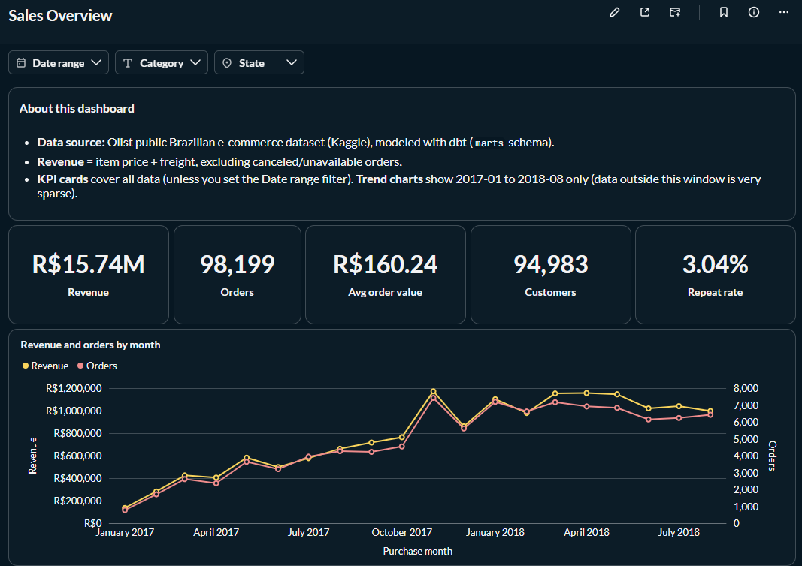
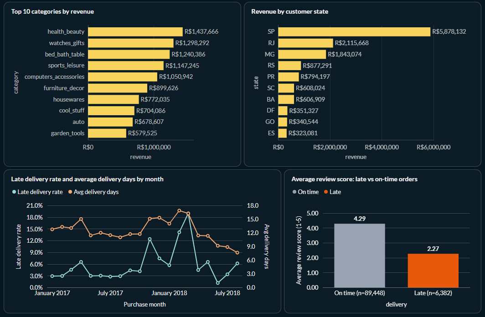
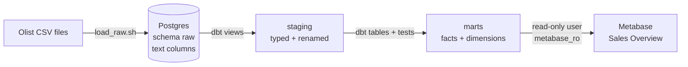

# Olist E-commerce Analytics: from raw CSV exports to trusted dashboards

An analytics stack (PostgreSQL, dbt, Metabase) that turns ~100k raw
e-commerce orders into tested data models and a dashboard built from code.

**Headline results**

- **Revenue reconciled to the cent.** R$15,735,527.03 is the same in the raw
  tables and in every mart. The ~1% gap to total payments is explained down
  to the last centavo.
- **4x to 15x faster dashboard queries** compared with querying the raw source
  tables, with byte-identical results.
- **Late deliveries get much worse reviews:** 2.27 stars on average vs 4.29
  for on-time orders.
- **38 automated data tests** run on every build. The dashboard is rebuilt
  from a script, so nothing depends on manual clicks.




---

## The problem

An online marketplace exports its data as 9 CSV files: orders, items,
payments, reviews, customers, products, sellers and so on. Everything is text,
and nothing is joined. This causes two problems:

- **No trusted numbers.** "Revenue" can be computed from payments or from
  items, with or without canceled orders, and each choice gives a different
  total. Two people get two answers.
- **Slow, repeated work.** Every ad-hoc question re-joins 3 to 5 tables and
  re-casts text to dates and numbers, with the business rules re-typed
  (and sometimes mistyped) each time.

## Architecture



| layer | why it exists |
|---|---|
| **raw** | An exact copy of the source files, all text, so a bad type cast can never lose data on load. |
| **staging** | One view per source table. Types are cast and names cleaned **once**, in one place. |
| **marts** | Business-ready tables (`fct_orders`, `fct_order_items`, `dim_customers`, `dim_products`, `fct_revenue_monthly`). Joins and business rules are computed once at build time, then tested. |
| **Metabase** | Dashboards read **only** the marts, through a user that cannot write. |

---

## Story 1: Which revenue number is right?

Total payments are **R$16,008,872.12**. Item price + freight is
**R$15,843,553.24**. That is a **R$165,318.88 (1.04%)** gap. Instead of
picking one number, the gap was broken down until every centavo was explained:

| part of the gap | amount (R$) |
|---|---:|
| Payments on orders that have **no item rows**: 775 orders, mostly `unavailable` (603) or `canceled` (164); 3 of the canceled ones were paid R$0.00 | 162,591.95 |
| Customers paid **more** than items + freight. R$3,064.38 of this is on orders paid in several installments, which fits installment interest | 3,071.17 |
| Customers paid **less** than items + freight (for example vouchers or rounding) | −344.24 |
| **Total** | **165,318.88** |

**Decision:** revenue = item price + freight, excluding `canceled` and
`unavailable` orders, giving **R$15,735,527.03**. Raw SQL, `fct_orders`,
`fct_order_items` and `fct_revenue_monthly` all return exactly this number.

The full definition, and why dashboard KPIs differ from mart row counts, is in
[`olist_analytics/models/marts/_docs.md`](olist_analytics/models/marts/_docs.md).

## Story 2: Late delivery and review scores

An order is **late** when it arrives on a later day than the date promised to
the customer. Among delivered orders with a review:

| delivery | orders | avg review | 1-2 stars | 5 stars |
|---|---:|---:|---:|---:|
| On time | 89,448 | **4.29** | 9.3% | 62.3% |
| Late | 6,382 | **2.27** | 62.4% | 16.5% |

Only 6.7% of these orders were late, but most late orders got a 1 or 2 star
review. The later the order, the lower the score: 3.29 when 1-3 days late,
2.10 at 4-7 days, 1.70 at 8 days or more.

This is a strong **association**, not proof of cause. Late orders may also
differ in other ways (region, seller, product size). Still, it makes delivery
promises an obvious place to look.

## Story 3: Black Friday 2017 and the late-delivery peaks

| month | orders | revenue (R$) | late rate | avg delivery days |
|---|---:|---:|---:|---:|
| 2017-10 | 4,547 | 764,756 | 4.2% | 11.7 |
| **2017-11** | **7,421** | **1,172,192** | **12.4%** | 15.1 |
| 2017-12 | 5,618 | 861,527 | 7.5% | 15.3 |
| 2018-01 | 7,187 | 1,101,920 | 5.7% | 14.0 |
| **2018-02** | 6,624 | 979,486 | **14.1%** | 16.9 |
| **2018-03** | 7,168 | 1,152,657 | **19.0%** | 16.2 |
| 2018-04 | 6,919 | 1,156,249 | 4.5% | 11.4 |

- **November 2017** is the highest month for orders and revenue. Orders rose 63%
  over October. The busiest single day was **24 Nov 2017 (Black Friday)**, with
  1,166 orders, more than twice any other day that month.
- The late rate **nearly tripled** in November 2017 (4.2% → 12.4%), the same month
  as the order spike.
- The **highest** late rates came in **February and March 2018** (14.1%, 19.0%),
  **without** a matching order spike: volume there is similar to January and
  April. Something other than order volume was involved, and this dataset
  does not show what it was.

Month = purchase month; late rate is over delivered orders. Orders/revenue
follow the revenue rule above.

---

## Performance

Three typical dashboard queries were timed on the raw source tables, on the
staging views, and on the marts (with and without two covering indexes). Every
version returns byte-identical results. Times are medians in ms:

| dashboard query | raw tables | marts + indexes | vs querying raw |
|---|---:|---:|---:|
| Monthly trend, one state | 129.6 | 31.7 | 4.1x faster |
| Top 10 categories, date range | 145.2 | 14.9 | 9.8x faster |
| Review score, late vs on-time | 539.6 | 36.2 | 14.9x faster |

These speed-ups compare marts with querying the raw source tables, not with
a tuned alternative. The dataset is small, so absolute times are small too.
Method, pages read, index decisions and caveats are in
[docs/performance.md](docs/performance.md).

## Engineering practices

- **Dashboards as code.** [`scripts/metabase/build_sales_dashboard.py`](scripts/metabase/build_sales_dashboard.py)
  creates or updates every card and the dashboard through the Metabase API. It
  is idempotent (re-running updates in place, no duplicates) and then runs each
  card, with and without filters, to check it works.
- **Tested models.** 38 dbt tests (unique, not null, relationships, accepted
  values) run with every `dbt build`.
- **Read-only BI user.** Metabase connects as `metabase_ro`, which can only
  `SELECT` from `marts`, and every session is read-only
  ([`scripts/create_metabase_ro.sql`](scripts/create_metabase_ro.sql)).
- **Documented metric definitions.** Revenue, order status and KPI
  reconciliation are written down in dbt docs
  ([`_docs.md`](olist_analytics/models/marts/_docs.md)) and on the dashboard.
- **Secrets in `.env` only.** dbt reads credentials with `env_var()`. `.env`
  and the data files are git-ignored, and [`.env.example`](.env.example) lists
  the variables.
- **Ports bound to localhost.** Postgres (5433) and Metabase (3000) listen on
  `127.0.0.1` only.

---

## How to run

Requirements: Docker with Compose, Python 3, and the Olist CSV files.

1. **Clone and configure**

   ```bash
   git clone https://github.com/zeyadosmoh/olist-analytics.git olist-analytics && cd olist-analytics
   cp .env.example .env        # then edit .env and set your own passwords
   ```

2. **Get the data.** Download the dataset from
   [Kaggle](https://www.kaggle.com/datasets/olistbr/brazilian-ecommerce) and
   unzip the 9 CSV files into `data/raw/`.

3. **Start Postgres and Metabase**

   ```bash
   docker compose up -d
   ```

4. **Load the raw tables** (schema `raw`, all columns text)

   ```bash
   ./load_raw.sh
   ```

5. **Build and test the models with dbt**

   ```bash
   python3 -m venv .venv && source .venv/bin/activate
   pip install -r requirements.txt
   set -a && source .env && set +a
   (cd olist_analytics && dbt build)
   ```

6. **Create the read-only Metabase user** (run after `dbt build`, so the
   `marts` schema exists)

   ```bash
   ./scripts/create_metabase_ro.sh
   ```

7. **Connect Metabase** at http://localhost:3000:
   - Create the admin account.
   - Add a PostgreSQL database: host `postgres`, port `5432`, database `olist`,
     user `metabase_ro`, password = `MB_DB_PASSWORD` from `.env`. Wait for the
     first sync to finish.
   - Under *Admin settings > Authentication > API keys*, create a key in the
     Administrators group and set it as `MB_API_KEY` in `.env`.

8. **Build the dashboard**

   ```bash
   python scripts/metabase/build_sales_dashboard.py
   ```

   It prints the dashboard URL and checks that every card runs.

Optional: `python benchmarks/run_benchmarks.py` re-runs the performance tests
(see [docs/performance.md](docs/performance.md#reproduce)), and
`cd olist_analytics && dbt docs generate && dbt docs serve` opens the model docs.

## Data

[Brazilian E-Commerce Public Dataset by Olist](https://www.kaggle.com/datasets/olistbr/brazilian-ecommerce),
published on Kaggle under the **CC BY-NC-SA 4.0** license. It contains
~100k anonymized orders placed from 2016 to 2018. The data is not included in
this repository. Trend charts use 2017-01 to 2018-08, because the months
outside that window have very few orders.
